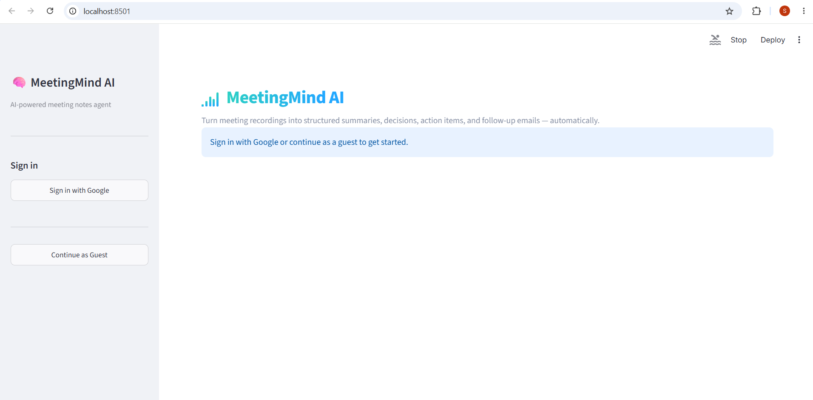
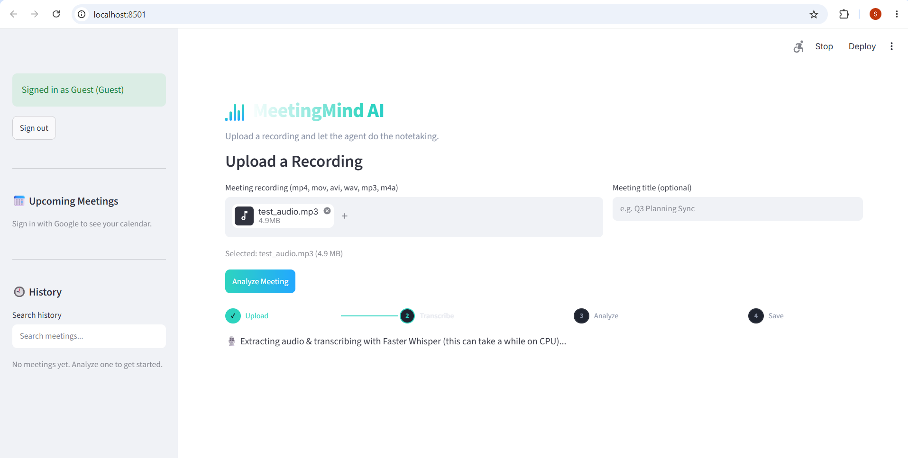
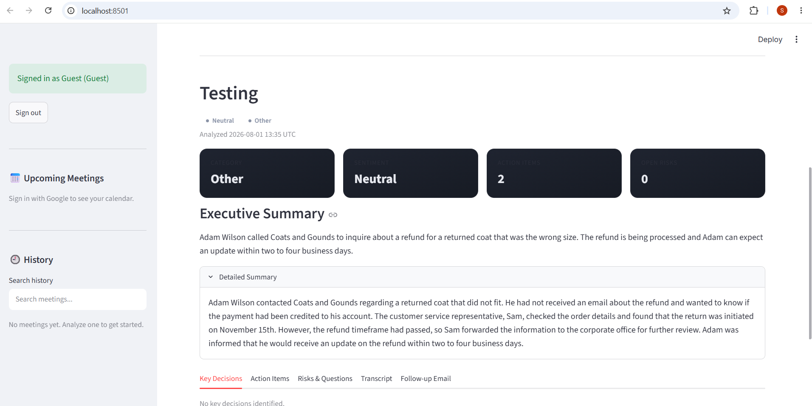

# 🧠 MeetingMind AI

An AI-powered Meeting Notes Agent that converts raw meeting recordings (or
transcripts) into structured summaries, decisions, action items, risks, and
follow-up emails — built as a full Streamlit SaaS application, not a script.

**Input:** a meeting recording (or transcript)
**Output:** executive summary, detailed summary, key decisions, action items
(with owner/due date/priority), risks, blockers, open questions, sentiment,
keywords, category, a suggested next meeting, and a follow-up email draft —
all persisted to a searchable meeting history.

---

## 1. Architecture

```
Google Login (or Guest Mode)
        │
        ▼
Read Google Calendar (read-only)
        │
        ▼
Upload Meeting Recording (mp4 / mov / avi / wav / mp3 / m4a)
        │
        ▼
FFmpeg: extract & normalize audio (16kHz mono WAV)
        │
        ▼
Faster Whisper (local, CPU, int8) → Transcript
        │
        ▼
Meeting Agent (Groq · llama-3.3-70b-versatile) → Strict JSON
        │
        ▼
Pydantic Validation (auto-retry once on invalid JSON)
        │
        ▼
Supabase PostgreSQL (persist) + Supabase Storage
        │
        ▼
Streamlit Dashboard (view / search / export)
```

### Folder structure

```
MeetingMindAI/
├── app.py                # Streamlit dashboard (UI, upload, results, downloads)
├── config.py              # Env loading, logging, lazy client singletons
├── transcriber.py         # Faster Whisper + FFmpeg audio extraction
├── meeting_agent.py       # Groq integration, JSON parsing, validation retry
├── database.py            # Supabase CRUD (insert / history / delete / search)
├── models.py               # Pydantic schema (ActionItem, MeetingAnalysis, MeetingRecord)
├── prompts.py              # System prompt, prompt engineering, retry prompt
├── auth.py                 # Google OAuth flow + Guest Mode
├── calendar_service.py     # Read-only Google Calendar (today / upcoming)
├── utils.py                 # Date/formatting helpers, Markdown/JSON/TXT export
├── requirements.txt
├── .env.example
├── uploads/                 # Raw uploaded recordings (gitignored contents)
├── outputs/                  # Generated export files
└── temp/                      # Intermediate FFmpeg WAV files (auto-cleaned)
```

### Why this architecture

Each module has a single, explicit responsibility and communicates through
typed Pydantic models rather than loosely-shaped dicts, so a change to the
LLM's output schema (`models.py`) propagates as a type error everywhere it
matters instead of a silent `KeyError` at runtime. No agent framework
(LangChain/CrewAI/AutoGen/LlamaIndex/Haystack) is used — `meeting_agent.py`
calls the Groq SDK directly, which keeps the control flow (one call, one
conditional retry) fully auditable in ~150 lines instead of hidden inside a
framework's internals.

---

## 2. Tech Stack

| Layer | Choice | Why |
|---|---|---|
| Frontend | Streamlit | Fast to build a real dashboard UI without a separate frontend build step |
| Speech-to-text | Faster Whisper (local, CPU, int8) | Free, runs offline, no per-minute transcription cost |
| LLM | Groq — `llama-3.3-70b-versatile` | Very low latency inference, generous free tier, strong JSON-following behavior |
| Database | Supabase PostgreSQL | Managed Postgres with a simple Python client; `jsonb` fits the nested analysis object naturally |
| Storage | Supabase Storage | Same project as the DB, no extra credentials to manage |
| Auth | Google OAuth 2.0 | Matches the calendar integration; Guest Mode covers users who skip it |
| Calendar | Google Calendar API (read-only) | Surfaces today's/upcoming meetings; never writes to the user's calendar |
| Validation | Pydantic v2 | Strict schema enforcement + automatic normalization of missing owner/date |
| Config | python-dotenv | Keeps all secrets out of source code |

---

## 3. Installation

### Prerequisites
- Python 3.11+
- [FFmpeg](https://ffmpeg.org/download.html) installed and on your `PATH`
  (`ffmpeg -version` should work in your terminal)
- A Groq API key, a Supabase project, and (optionally) Google OAuth credentials

### Steps

```bash
git clone <this-repo>
cd MeetingMindAI

python3 -m venv .venv
source .venv/bin/activate        # Windows: .venv\Scripts\activate

pip install -r requirements.txt

cp .env.example .env
# now edit .env and fill in your real values (see section 4)

streamlit run app.py
```

The app opens at `http://localhost:8501`.

---

## 4. Environment Variables

Copy `.env.example` to `.env` and fill in:

| Variable | Required | Description |
|---|---|---|
| `GROQ_API_KEY` | Yes | Enables meeting analysis |
| `GROQ_MODEL` | No | Defaults to `llama-3.3-70b-versatile` |
| `SUPABASE_URL` | Yes, for history | Your Supabase project URL |
| `SUPABASE_KEY` | Yes, for history | Service or anon key with table access |
| `GOOGLE_CLIENT_ID` | No | Enables Google Sign-In |
| `GOOGLE_CLIENT_SECRET` | No | Enables Google Sign-In |
| `GOOGLE_REDIRECT_URI` | No | Defaults to `http://localhost:8501` |
| `WHISPER_MODEL_SIZE` | No | Defaults to `base` |
| `WHISPER_DEVICE` | No | Defaults to `cpu` |
| `WHISPER_COMPUTE_TYPE` | No | Defaults to `int8` |

**Never commit `.env` or any downloaded OAuth `client_secret*.json` file to
version control.** If a secret is ever pasted into a chat, document, ticket,
or committed by mistake, treat it as compromised and rotate it immediately
in the Groq console, Supabase project settings, and Google Cloud Console
respectively.

The app degrades gracefully if optional integrations aren't configured:
without Supabase, analysis still works but history is disabled; without
Google OAuth, users are limited to Guest Mode.

### API setup

**Groq:** create a key at `console.groq.com/keys`.

**Supabase:** create a project, then in the SQL editor run:

```sql
create table if not exists meetings (
    id text primary key,
    user_email text not null default 'guest',
    title text not null default 'Untitled Meeting',
    source_filename text,
    transcript text not null,
    analysis jsonb not null,
    created_at timestamptz not null default now()
);
create index if not exists meetings_user_email_idx on meetings (user_email);
create index if not exists meetings_created_at_idx on meetings (created_at desc);
```

Copy the Project URL and an API key (service_role for local dev, or anon +
row-level-security policies for production) into `.env`.

**Google OAuth:** in Google Cloud Console → APIs & Services → Credentials,
create an OAuth 2.0 Client ID of type "Web application", add
`http://localhost:8501` as an authorized redirect URI, enable the Google
Calendar API, and copy the client ID/secret into `.env`. Do not commit the
downloaded JSON file — extract just the two values into `.env` and delete it.

**Faster Whisper:** no setup required; the `base` model (~150MB) downloads
automatically on first use and is cached locally afterward.

---

## 5. How to Run

```bash
streamlit run app.py
```

1. Sign in with Google, or click "Continue as Guest".
2. (Optional) Review today's/upcoming meetings pulled from your calendar.
3. Upload a recording and optionally give it a title.
4. Click **Analyze Meeting** — watch the progress bar move through
   transcription and AI analysis.
5. Review the executive summary, decisions, action items table, risks, and
   follow-up email draft across tabs.
6. Download the report as Markdown, JSON, or TXT.
7. Revisit or search past meetings from the sidebar history.

---

## 6. Screenshots

### Sign-in Screen


### Upload & Progress View


### Summary Cards & Action Items


---

## 7. Error Handling

The app handles and surfaces (rather than crashing on):

- Empty or oversized uploads
- Unsupported file formats
- FFmpeg missing or failing to extract audio
- Whisper producing no transcribable speech
- Groq API failures or malformed JSON (one automatic retry with an
  error-correction prompt before failing loudly)
- Supabase connectivity/query failures (analysis still completes; only
  persistence is skipped, with a visible warning)
- Google OAuth/Calendar failures (falls back to Guest Mode / hides the
  calendar widget with a warning)

---

## 8. Tradeoffs

- **Local Whisper vs. hosted transcription APIs:** free and private, but
  CPU-only inference is slow on long recordings and `base` model accuracy
  is lower than `medium`/`large-v3` — chosen to keep the app runnable
  without a GPU or per-minute API cost.
- **Groq vs. OpenAI-class hosted models:** very low latency and a free
  tier, at the cost of slightly less mature JSON-mode tooling than some
  competitors — mitigated with an explicit strict-JSON prompt and a
  single validation retry rather than relying on a native JSON mode.
- **No agent framework:** more code to write for orchestration, in
  exchange for a fully auditable, dependency-light control flow with no
  framework-specific failure modes or version churn.
- **Single retry on invalid JSON:** bounds latency/cost predictably;
  a small fraction of transcripts may still fail analysis and require the
  user to re-run.
- **Guest Mode:** keeps the app usable without any Google setup, but guest
  history is shared under one `user_email` bucket rather than per-device.

## 9. Limitations

- Whisper `base` on CPU is not real-time; a 60-minute recording can take
  several minutes to transcribe depending on hardware.
- No speaker diarization — transcripts are a single continuous stream of
  text, not attributed to individual speakers.
- Relative dates in speech ("by next Friday") are only resolved when the
  transcript or UI provides enough context to anchor them; otherwise the
  agent intentionally returns `null` rather than guessing.
- Calendar integration is read-only by design and cannot create or update
  events.
- Supabase row-level security is left to the deployer to configure for
  multi-tenant production use; the schema above is a minimal starting
  point.

## 10. Future Improvements

- Speaker diarization (e.g. via pyannote) to attribute statements/action
  items to specific speakers.
- Background/async job processing for large files instead of blocking the
  Streamlit thread during transcription.
- Real-time streaming transcription for live meetings.
- Slack/email delivery of the follow-up email draft directly from the app.
- Multi-language summarization (Whisper already detects language; the
  agent prompt can be extended to respond in the source language).
- Row-level security policies and per-user API rate limiting for a
  production multi-tenant deployment.
